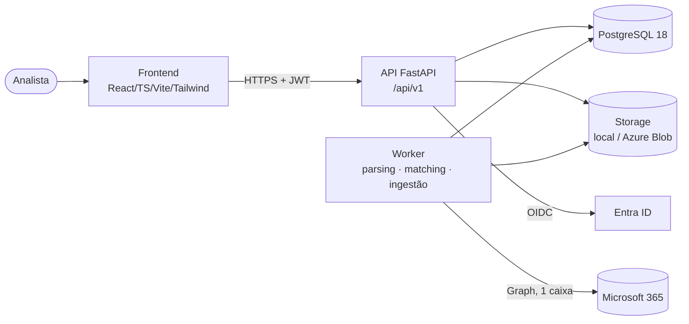

# Arquitetura — visão geral

> Resumo. Detalhes em [`docs/architecture.md`](docs/architecture.md); decisões em
> [`docs/decisions/`](docs/decisions/README.md).

## Decisões-chave

| Tema         | Decisão                                                                   | ADR |
| ------------ | ------------------------------------------------------------------------- | --- |
| Estilo       | Monólito modular em camadas, monorepo                                     | 006 |
| Stack        | React/TS/Vite/Tailwind · Python 3.13/FastAPI/Pydantic/SQLAlchemy · uv/npm | 001 |
| Banco        | PostgreSQL 18, Alembic, UUID, `timestamptz` UTC                           | 002 |
| Arquivos     | Storage abstrato por SHA-256; nada de BLOB no banco                       | 003 |
| Identidade   | Entra ID (OIDC); DEV auth só local com fail-fast; RBAC no backend         | 004 |
| Regras       | Determinísticas, puras, versionadas, explicáveis; sem LLM                 | 005 |
| Dinheiro     | `Decimal`/`NUMERIC`, tolerâncias configuráveis                            | 007 |
| CNPJ         | String, alfanumérico, value object único                                  | 008 |
| Assíncrono   | Fila em tabela PostgreSQL (`SKIP LOCKED`), sem broker                     | 009 |
| Tenancy      | `organization_id` em tudo; 1 organização por implantação no MVP           | 010 |
| Idempotência | Hash/IDs externos/constraints; duplicidade fiscal registrada e sinalizada | 011 |
| Auditoria    | Append-only com grants restritos                                          | 012 |
| Idioma       | UI/docs pt-BR; código em inglês                                           | 013 |
| Infra/CI     | Bicep; GitHub Actions com OIDC; produção com aprovação manual             | 014 |
| M365         | Graph + RBAC for Applications, 1 caixa, polling                           | 015 |
| Parsers      | Versionados, XML seguro, layout desconhecido = erro explícito             | 016 |

## Camadas do backend

`api → services → domain`; `parsers`, `rules` e `matching` são puros (sem banco);
`repositories`/`models` isolam persistência; `integrations` isola serviços externos.
As regras de dependência são verificadas por teste automatizado
(`backend/tests/architecture/test_layer_dependencies.py`).
