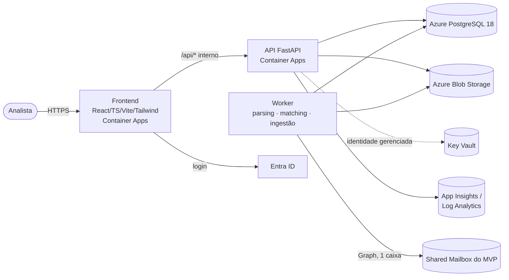

# Arquitetura — visão geral

> Resumo. Detalhes em [`docs/architecture.md`](docs/architecture.md); decisões em
> [`docs/decisions/`](docs/decisions/README.md).

Único ambiente de nuvem: **MVP** no Azure + Microsoft 365
([ADR-001](docs/decisions/ADR-001-mvp-cloud-first.md)). Arquitetura cloud detalhada:
[`docs/cloud-architecture.md`](docs/cloud-architecture.md).

## Decisões-chave

| Tema         | Decisão                                                                      | ADR |
| ------------ | ---------------------------------------------------------------------------- | --- |
| Estratégia   | MVP Cloud-First, um único ambiente (`mvp`)                                   | 001 |
| Stack        | React/TS/Vite/Tailwind · Python 3.13/FastAPI/Pydantic/SQLAlchemy · uv/npm    | 002 |
| Banco        | PostgreSQL 18 (Azure Flexible Server), Alembic, UUID, `timestamptz` UTC      | 003 |
| Assíncrono   | Fila em tabela PostgreSQL (`SKIP LOCKED`), sem broker                        | 004 |
| Arquivos     | Azure Blob Storage privado, chave por SHA-256; nada de BLOB no banco         | 005 |
| Identidade   | Entra ID (Easy Auth → JWT); DEV auth só local com fail-fast; RBAC no backend | 006 |
| M365         | Shared Mailbox dedicada + RBAC for Applications (1 caixa)                    | 007 |
| E-mail       | Polling via Graph delta query, idempotente                                   | 008 |
| Dinheiro     | `Decimal`/`NUMERIC`, precisão fiscal preservada                              | 009 |
| Idioma       | UI/docs pt-BR; código em inglês                                              | 010 |
| Rede         | VNet enxuta: PostgreSQL privado, API interna, sem Private Endpoints          | 011 |
| CNPJ         | String, alfanumérico, value object único                                     | 012 |
| Tenancy      | `organization_id` em tudo; 1 organização por implantação no MVP              | 013 |
| Idempotência | Hash/IDs externos/constraints; duplicidade fiscal registrada e sinalizada    | 014 |
| Auditoria    | Append-only com grants restritos                                             | 015 |
| Regras       | Determinísticas, puras, versionadas, explicáveis; sem LLM                    | 016 |
| Parsers      | Versionados, XML seguro, layout desconhecido = erro explícito                | 017 |
| Estilo       | Monólito modular em camadas, monorepo                                        | 018 |
| Infra/CI     | Bicep + scripts M365 idempotentes; GitHub Actions com OIDC (Sprint 9)        | 019 |

## Camadas do backend

`api → services → domain`; `parsers`, `rules` e `matching` são puros (sem banco);
`repositories`/`models` isolam persistência; `integrations` isola serviços externos.
As regras de dependência são verificadas por teste automatizado
(`backend/tests/architecture/test_layer_dependencies.py`).
