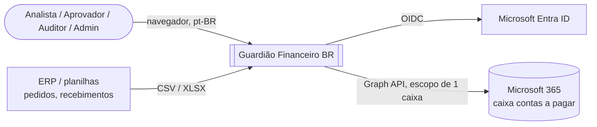
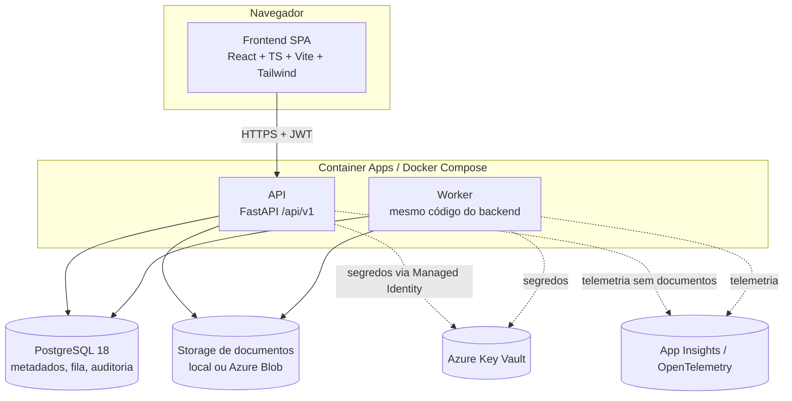
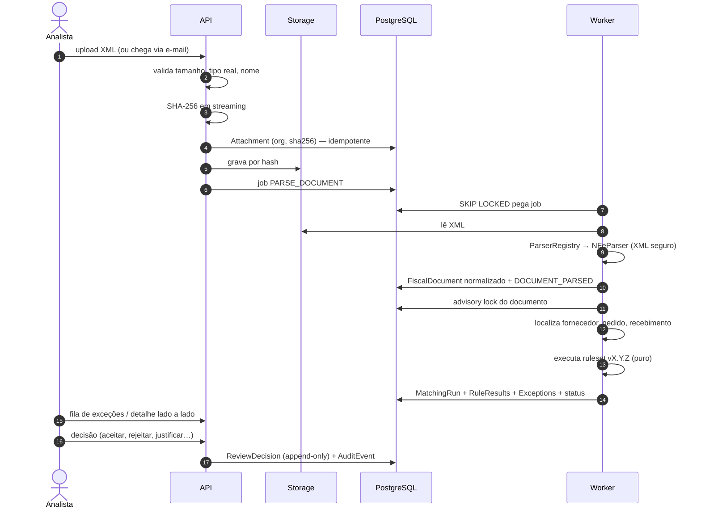

# Arquitetura — Guardião Financeiro BR

> Documento vivo. Visão geral resumida em [`../ARCHITECTURE.md`](../ARCHITECTURE.md).
> Decisões em [`decisions/`](decisions/README.md).

## 1. Objetivo arquitetural

Conferir automaticamente documentos de contas a pagar (NF-e, NFS-e) contra pedidos e
recebimentos, **processando sozinhos os casos normais e encaminhando apenas exceções**
para análise humana — com explicabilidade, auditoria e segurança desde o início.

Restrições que moldam a arquitetura:

- Funciona **localmente sem Azure** e **sem qualquer LLM** (seção 58 do escopo).
- Não é ERP, não paga, não escritura, não afirma correção fiscal/jurídica.
- Simplicidade primeiro: monólito modular, fila em PostgreSQL, sem broker (ADR-006, ADR-009).

## 2. Contexto (C4 — nível 1)



## 3. Containers (C4 — nível 2)



| Container  | Responsabilidade                                                 | Local                   | Azure (Sprint 8)         |
| ---------- | ---------------------------------------------------------------- | ----------------------- | ------------------------ |
| Frontend   | UI pt-BR, experiência; nenhuma decisão de autorização ou cálculo | Vite dev server / Nginx | Container App (estático) |
| API        | REST versionada, authN/authZ, orquestração                       | Uvicorn                 | Container App            |
| Worker     | parsing, matching, ingestão de e-mail, jobs                      | processo Python         | Container App / Job      |
| PostgreSQL | metadados, fila `job`, auditoria                                 | Docker                  | Flexible Server          |
| Storage    | arquivos originais, por hash                                     | disco local             | Blob Storage privado     |

## 4. Backend — camadas (C4 — nível 3)

```text
backend/app/
├── api/           # Rotas FastAPI /api/v1, dependências de auth, DTOs de entrada/saída
├── schemas/       # Modelos Pydantic da API (request/response)
├── services/      # Casos de uso: orquestram domínio, repositórios, storage e fila
├── domain/        # Núcleo puro: entidades de valor, Money, FiscalId, enums, erros
├── parsers/       # FiscalDocumentParser: XML → estrutura normalizada (puro)
├── rules/         # Regras determinísticas versionadas (puras)
├── matching/      # Three-way match: seleção de candidatos + agregação de status (puro)
├── models/        # ORM SQLAlchemy (tabelas)
├── repositories/  # Acesso a dados, sempre com escopo de organization_id
├── integrations/  # Adapters externos: storage, Microsoft Graph, Key Vault
├── security/      # Autenticação, permissões, sanitização de upload
├── audit/         # Emissão de eventos de auditoria
└── config/        # Settings (pydantic-settings), validação de ambiente
```

Regras de dependência (ADR-006), verificadas por `backend/tests/architecture/`:

| Camada                         | Não pode importar                                                                |
| ------------------------------ | -------------------------------------------------------------------------------- |
| `domain`                       | qualquer outra camada da app, SQLAlchemy, FastAPI                                |
| `parsers`, `rules`, `matching` | `models`, `repositories`, `api`, `services`, `integrations`, SQLAlchemy, FastAPI |
| `models`, `repositories`       | `api`, `services`                                                                |
| `api`                          | `models`, `repositories` (usa `services`)                                        |

## 5. Fluxo principal (alvo do MVP)



## 6. Status do three-way match

`MATCHED`, `MATCHED_WITH_WARNINGS`, `NEEDS_REVIEW`, `BLOCKED` — derivados de forma
determinística dos resultados das regras (tabela em [`matching-engine.md`](matching-engine.md)).

## 7. Preocupações transversais

| Tema                     | Abordagem                                                                                                                  | Onde              |
| ------------------------ | -------------------------------------------------------------------------------------------------------------------------- | ----------------- |
| Dinheiro                 | `Decimal` / `NUMERIC`, tolerâncias configuráveis                                                                           | ADR-007           |
| Identificador fiscal     | Value object único, CNPJ alfanumérico                                                                                      | ADR-008           |
| Idempotência             | hash, IDs externos, constraints, `Idempotency-Key`                                                                         | ADR-011           |
| Concorrência             | advisory lock por documento + optimistic locking                                                                           | ADR-009           |
| Auditoria                | append-only, grants restritos                                                                                              | ADR-012           |
| Multitenancy             | `organization_id` em tudo                                                                                                  | ADR-010           |
| Segurança                | ver [`security.md`](security.md) e [`threat-model.md`](threat-model.md)                                                    | —                 |
| Privacidade              | ver [`lgpd.md`](lgpd.md)                                                                                                   | —                 |
| Logs                     | JSON estruturado, correlation IDs (`request_id`, `document_id`, `matching_run_id`, `organization_id`), sem dados sensíveis | Sprint 1          |
| Observabilidade          | OpenTelemetry → Application Insights; métricas de parser, matching, fila, Graph, storage                                   | Sprint 7/8        |
| Erros                    | códigos estáveis (`GFB-XXXX`), mensagens pt-BR sem traceback/SQL/caminhos                                                  | Sprint 1          |
| Configuração por empresa | tabela `configuration` versionada; snapshot por `MatchingRun`                                                              | Sprint 3/4        |
| Feature flags            | booleanos em `Configuration`/settings; sem plataforma dedicada                                                             | quando necessário |
| Performance              | paginação obrigatória, índices em campos de busca, streaming de arquivos, evitar N+1                                       | contínuo          |

## 8. Portabilidade

- Desenvolvimento: `docker compose up` (PostgreSQL + API + frontend a partir da Sprint 1).
- Microsoft 365: `MAILBOX_INGESTION_MODE=mock` por padrão.
- Azure: somente homologação/produção; nenhum recurso criado sem autorização.

## 9. Evolução prevista

Integrações ERP, OCR/IA assistiva (nunca decisória), Teams, webhooks, SaaS multiempresa —
ver [`roadmap.md`](roadmap.md). A arquitetura acomoda esses itens por meio de adapters
(`integrations/`), parsers versionados e `organization_id`.
