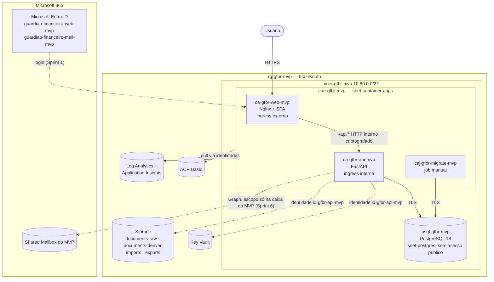

# Arquitetura cloud do MVP

> Único ambiente: **MVP** ([ADR-001](decisions/ADR-001-mvp-cloud-first.md)). Rede:
> [ADR-011](decisions/ADR-011-mvp-networking.md). Procedimento de deploy:
> [`deployment-azure.md`](deployment-azure.md).

## 1. Visão geral

## 2. Fluxos

| Fluxo                       | Caminho                                                                    | Controles                                                               |
| --------------------------- | -------------------------------------------------------------------------- | ----------------------------------------------------------------------- |
| Usuário → aplicação         | Internet → `ca-gfbr-web-mvp` (HTTPS) → `/api/*` → `ca-gfbr-api-mvp`        | TLS; API sem ingress externo; autenticação Entra a partir da Sprint 1   |
| API → banco                 | Container Apps (VNet) → PostgreSQL (sub-rede delegada, DNS privado)        | Sem endpoint público; TLS obrigatório; senha só no Key Vault            |
| API → segredos              | Referência de segredo do Container Apps → Key Vault                        | Identidade gerenciada, papel Key Vault Secrets User                     |
| API → documentos (Sprint 2) | Identidade gerenciada → Blob Storage                                       | Sem chave compartilhada nem acesso anônimo; papel Blob Data Contributor |
| Deploy de imagens           | Máquina do responsável → ACR (`AcrPush`); Container Apps ← ACR (`AcrPull`) | Sem admin user; identidades gerenciadas                                 |
| Migrations                  | Job `caj-gfbr-migrate-mvp` dentro da VNet                                  | Executado pelo script de deploy                                         |
| E-mail (Sprint 6)           | Graph → Shared Mailbox do MVP                                              | RBAC for Applications limitado à caixa; sem `Mail.*` no Entra ID        |
| Telemetria                  | Container Apps → Log Analytics / Application Insights                      | Sem conteúdo de documentos; retenção 30 dias; limite diário             |

## 3. Rede

| Item                  | Valor                                                   |
| --------------------- | ------------------------------------------------------- |
| VNet                  | `vnet-gfbr-mvp` — `10.60.0.0/22`                        |
| `snet-container-apps` | `10.60.0.0/24`, delegada a `Microsoft.App/environments` |
| `snet-postgres`       | `10.60.1.0/28`, delegada ao PostgreSQL Flexible Server  |
| Zona DNS privada      | `gfbr-mvp.private.postgres.database.azure.com`          |
| Reservado             | `10.60.1.16` – `10.60.3.255`                            |

Sem Private Endpoints, NAT Gateway, firewall ou peering. Storage, Key Vault e ACR usam
endpoints públicos protegidos por Entra ID/RBAC (justificativa e riscos no ADR-011).

## 4. Identidades e permissões

| Identidade                     | Tipo                  | Permissões                                                                                       |
| ------------------------------ | --------------------- | ------------------------------------------------------------------------------------------------ |
| `id-gfbr-api-mvp`              | Managed Identity      | `AcrPull` (ACR), `Key Vault Secrets User` (Key Vault), `Storage Blob Data Contributor` (Storage) |
| `id-gfbr-web-mvp`              | Managed Identity      | `AcrPull` (ACR)                                                                                  |
| Responsável pelo deploy        | Usuário Entra         | `AcrPush` (ACR), `Key Vault Secrets Officer` (Key Vault), além do papel na assinatura            |
| `guardiao-financeiro-web-mvp`  | App Registration + SP | App Roles da aplicação; nenhuma permissão Graph                                                  |
| `guardiao-financeiro-mail-mvp` | App Registration + SP | Somente `Application Mail.Read` no escopo da caixa do MVP (Exchange RBAC)                        |

Nenhuma identidade de runtime recebe `Owner` ou `Contributor`. A identidade do worker e a
identidade de deploy do GitHub (OIDC) serão criadas nas sprints que as exigirem.

## 5. Segredos

| Segredo                                   | Onde vive | Quem lê                       | Quando nasce |
| ----------------------------------------- | --------- | ----------------------------- | ------------ |
| `postgres-admin-password`                 | Key Vault | `id-gfbr-api-mvp` (API e job) | Sprint 0     |
| Segredo do Easy Auth                      | Key Vault | Container Apps (referência)   | Sprint 1     |
| Credencial do app de e-mail (certificado) | Key Vault | worker de ingestão            | Sprint 6     |

Nada disso aparece no repositório, em imagens, no frontend, na documentação ou em logs.

## 6. Dados e classificação

- Somente dados fictícios no MVP até decisão em contrário
  ([`synthetic-data-policy.md`](synthetic-data-policy.md)); tag `data-classification=business`
  porque o ambiente foi desenhado para dados empresariais.
- Documentos originais: Blob Storage (`documents-raw`); metadados: PostgreSQL.
- Backups e retenção: [`backup-restore.md`](backup-restore.md).

## 7. O que ainda não existe (e por quê)

| Item                                   | Quando               |
| -------------------------------------- | -------------------- |
| Login Entra ID no frontend             | Sprint 1 (Easy Auth) |
| Uso do Blob Storage pela aplicação     | Sprint 2             |
| Worker e fila de processamento         | Sprints 2/4/6        |
| Leitura de e-mail                      | Sprint 6             |
| Alertas operacionais e restore testado | Sprint 8             |
| CI/CD com OIDC                         | Sprint 9             |
