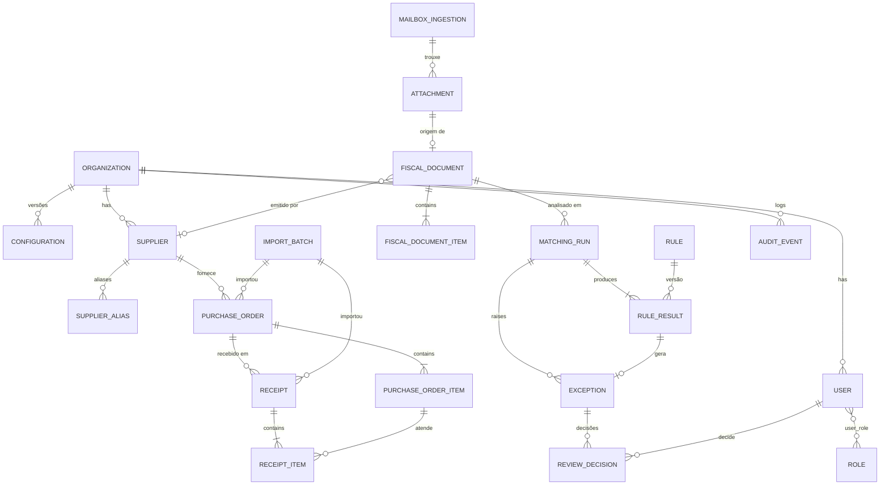

# Modelo de domínio inicial

> Modelo conceitual. Tipos físicos entram por migrations Alembic sprint a sprint.
> Nomes de código em inglês (ADR-010). Banco do MVP: `guardiao_financeiro` (PostgreSQL 18).

> **Já implementado (migration `0001`, base reaproveitada):** `organization`, `configuration`
> (sobrescritas versionadas, append-only) e `audit_event` (append-only). As demais
> entidades entram nas sprints seguintes.

## 1. Convenções

- PK `id UUID`; `organization_id UUID NOT NULL` em toda entidade empresarial (ADR-013).
- `created_at`, `updated_at` em `timestamptz` UTC; entidades revisáveis têm `version INT`
  (optimistic locking).
- Dinheiro `NUMERIC(18,2)`, unitário `NUMERIC(23,10)`, quantidade `NUMERIC(19,4)`,
  alíquota/percentual `NUMERIC(9,4)`; precisão original do XML preservada (ADR-009).
- CNPJ/CPF como `VARCHAR(14)` normalizado (ADR-012).
- Enum persistido como `VARCHAR` + `CHECK` (evita migrations dolorosas de `ENUM` nativo).
- Tabelas históricas (`audit_event`, `review_decision`, `rule_result`) são append-only.

## 2. Diagrama

## 3. Entidades

| Entidade                                    | Propósito                                         | Atributos principais                                                                                                                                                                                                                                                                                                                                    | Unicidade / índices                                                                                                           |
| ------------------------------------------- | ------------------------------------------------- | ------------------------------------------------------------------------------------------------------------------------------------------------------------------------------------------------------------------------------------------------------------------------------------------------------------------------------------------------------- | ----------------------------------------------------------------------------------------------------------------------------- |
| **Organization**                            | Empresa usuária (1 por implantação no MVP)        | `legal_name`, `tax_id` (CNPJ destinatário esperado), `status`                                                                                                                                                                                                                                                                                           | `tax_id`                                                                                                                      |
| **User**                                    | Pessoa autenticada via Entra ID                   | `entra_object_id`, `display_name`, `email`, `status`, `last_login_at`                                                                                                                                                                                                                                                                                   | `(organization_id, entra_object_id)`                                                                                          |
| **Role**                                    | Perfil: `ADMIN`, `ANALYST`, `APPROVER`, `AUDITOR` | `code`, `description`                                                                                                                                                                                                                                                                                                                                   | `code`                                                                                                                        |
| **Supplier**                                | Fornecedor                                        | `tax_id`, `legal_name`, `trade_name`, `status`, dados básicos                                                                                                                                                                                                                                                                                           | `(organization_id, tax_id)`                                                                                                   |
| SupplierAlias                               | Nomes conhecidos alternativos                     | `supplier_id`, `alias`, `source`                                                                                                                                                                                                                                                                                                                        | `(supplier_id, normalized_alias)`                                                                                             |
| **PurchaseOrder**                           | Pedido de compra                                  | `po_number`, `supplier_id`, `supplier_tax_id`, `issue_date`, `currency`(BRL), `total_amount`, `cost_center`, `requester`, `status`, `import_batch_id`                                                                                                                                                                                                   | `(organization_id, po_number)`                                                                                                |
| **PurchaseOrderItem**                       | Item do pedido                                    | `line_number`, `item_code`, `description`, `quantity`, `unit_price`, `total_amount`                                                                                                                                                                                                                                                                     | `(purchase_order_id, line_number)`                                                                                            |
| **Receipt**                                 | Recebimento / atesto                              | `receipt_number`, `purchase_order_id`, `received_at`, `type` (`GOODS`/`SERVICE`), `completeness` (`PARTIAL`/`TOTAL`), `received_by`                                                                                                                                                                                                                     | `(organization_id, receipt_number)`                                                                                           |
| **ReceiptItem**                             | Item recebido                                     | `purchase_order_item_id`, `quantity_received`, `notes`                                                                                                                                                                                                                                                                                                  | —                                                                                                                             |
| **FiscalDocument**                          | NF-e / NFS-e normalizada                          | `document_type` (`NFE`/`NFSE`), `layout_version`, `access_key`, `number`, `series`, `model`, `issue_date`, `issuer_tax_id`, `issuer_name`, `recipient_tax_id`, totais (produtos, desconto, frete, outras, impostos, IBS, CBS, total), `additional_info`, `attachment_id`, `supplier_id`, `processing_status`, `match_status`, `unmapped_fields` (JSONB) | idx `(organization_id, access_key)`; idx `(organization_id, issuer_tax_id, number, series, model)` — **não únicos** (ADR-014) |
| **FiscalDocumentItem**                      | Item do documento                                 | `line_number`, `product_code`, `description`, `ncm`, `cfop`, `unit`, `quantity`, `unit_price`, `total_amount`, `discount`, impostos por item (JSONB tipado), IBS/CBS                                                                                                                                                                                    | `(fiscal_document_id, line_number)`                                                                                           |
| **Attachment**                              | Arquivo recebido                                  | `sha256`, `size_bytes`, `detected_mime`, `declared_mime`, `original_filename` (sanitizado), `storage_key`, `source` (`UPLOAD`/`EMAIL`/`IMPORT`), `uploaded_by`                                                                                                                                                                                          | `(organization_id, sha256)`                                                                                                   |
| **ImportBatch**                             | Importação CSV/XLSX                               | `import_type`, `attachment_id`, `status`, `rows_processed/imported/ignored/invalid`, `error_report` (JSONB)                                                                                                                                                                                                                                             | `(organization_id, sha256, import_type)`                                                                                      |
| **MatchingRun**                             | Uma execução do motor                             | `fiscal_document_id`, `ruleset_version`, `config_snapshot` (JSONB), `started_at`, `finished_at`, `result_status`, `triggered_by`                                                                                                                                                                                                                        | idx `(fiscal_document_id, started_at)`                                                                                        |
| **Rule**                                    | Catálogo de regras                                | `code`, `version`, `title`, `description`, `default_severity`, `enabled`                                                                                                                                                                                                                                                                                | `(code, version)`                                                                                                             |
| **RuleResult**                              | Resultado de uma regra                            | `matching_run_id`, `rule_code`, `rule_version`, `outcome`, `severity`, `evidence` (JSONB), `explanation`, `evaluated_at`                                                                                                                                                                                                                                | append-only                                                                                                                   |
| **Exception** (`review_exception` no banco) | Divergência que requer humano                     | `fiscal_document_id`, `rule_result_id`, `type`, `severity`, `status` (`OPEN`/`ACCEPTED`/`REJECTED`/`RESOLVED`/`REANALYSIS_REQUESTED`), `amount_at_risk`, `opened_at`                                                                                                                                                                                    | idx `(organization_id, status, severity)`                                                                                     |
| **ReviewDecision**                          | Decisão humana                                    | `exception_id`, `user_id`, `action`, `justification`, `previous_state`, `new_state`, `decided_at`                                                                                                                                                                                                                                                       | append-only                                                                                                                   |
| **AuditEvent**                              | Trilha de auditoria                               | ver ADR-015                                                                                                                                                                                                                                                                                                                                             | append-only, idx `(organization_id, occurred_at)`                                                                             |
| **MailboxIngestion**                        | Mensagem/anexo processado do M365                 | `mailbox_address`, `internet_message_id`, `graph_message_id`, `sender`, `subject`, `received_at`, `attachment_id_graph`, `sha256`, `result`, `error_code`                                                                                                                                                                                               | ver ADR-014                                                                                                                   |
| **Configuration**                           | Política por empresa (versionada)                 | `key`, `value` (JSONB tipado), `version`, `changed_by`, `changed_at`                                                                                                                                                                                                                                                                                    | `(organization_id, key, version)`                                                                                             |
| **ProcessingJob** (`processing_job`)        | Fila de processamento (ADR-004)                   | `job_type`, `payload_reference`, `idempotency_key`, `status` (`PENDING`/`PROCESSING`/`COMPLETED`/`FAILED`/`DEAD`), `priority`, `attempt_count`, `max_attempts`, `available_at`, `locked_at`, `locked_by`, `last_error`, `created_at`, `updated_at`, `completed_at`                                                                                      | `(organization_id, idempotency_key)` único; idx parcial `(status, available_at, priority)`                                    |

> `Exception` colide com palavra reservada do Python; no código a entidade se chama
> `ReviewException` (tabela `review_exception`).

## 4. Configurações iniciais previstas

| Chave                             | Tipo                  | Padrão sugerido                               |
| --------------------------------- | --------------------- | --------------------------------------------- |
| `purchase_order_required`         | bool                  | `true`                                        |
| `purchase_order_missing_severity` | `WARNING`\|`CRITICAL` | `CRITICAL`                                    |
| `receipt_required`                | bool                  | `true`                                        |
| `amount_tolerance_absolute`       | Decimal (R$)          | `0.05`                                        |
| `amount_tolerance_percentage`     | Decimal (%)           | `0.50`                                        |
| `duplicate_window_days`           | int                   | `30`                                          |
| `old_document_threshold_days`     | int                   | `90`                                          |
| `future_date_tolerance_minutes`   | int                   | `10` (tolerância a relógios dessincronizados) |

Valores padrão são sugestões iniciais a validar com usuários (Sprint 4).

## 5. Glossário

| Termo                        | Código                        |
| ---------------------------- | ----------------------------- |
| Chave de acesso (44 dígitos) | `access_key`                  |
| Emitente / Destinatário      | `issuer` / `recipient`        |
| CNPJ/CPF                     | `tax_id`                      |
| Série / Número / Modelo      | `series` / `number` / `model` |
| Pedido de compra             | `purchase_order`              |
| Recebimento / Atesto         | `receipt`                     |
| Exceção (divergência)        | `review_exception`            |
| Conferência tripla           | `three_way_match`             |
