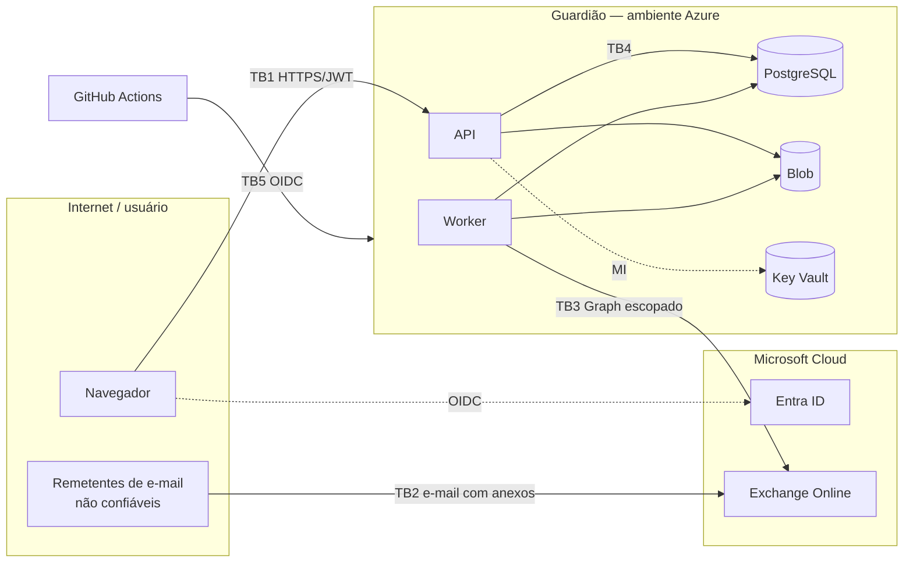

# Threat model inicial

> Sprint 0 — STRIDE sobre a arquitetura alvo. Revisão obrigatória nas Sprints 2, 6, 7 e 9.

## 1. Ativos

1. Documentos fiscais e anexos originais.
2. Dados de fornecedores, pedidos, recebimentos e valores.
3. Decisões de revisão e trilha de auditoria (integridade e não repúdio).
4. Credenciais: tokens Entra, certificado do app Graph, segredos no Key Vault.
5. Acesso à caixa de e-mail de contas a pagar.
6. Dados pessoais incidentais (CPF, nomes, e-mails).
7. Integridade do pipeline de CI/CD e das imagens.

## 2. Fronteiras de confiança

## 3. Ameaças (STRIDE)

| ID  | Categoria           | Ameaça                                                    | Mitigação                                                                                               | Sprint |
| --- | ------------------- | --------------------------------------------------------- | ------------------------------------------------------------------------------------------------------- | ------ |
| T01 | Spoofing            | Uso de auth DEV em produção                               | Quatro travas + fail-fast (ADR-004); teste automatizado                                                 | 1/7    |
| T02 | Spoofing            | Token forjado/expirado/de outro tenant ou audiência       | Validação completa de JWT (iss, aud, exp, assinatura, tenant)                                           | 7      |
| T03 | Spoofing            | E-mail forjado com NF-e fraudulenta                       | Documento sempre passa pelas regras; remetente é só metadado; destinatário/fornecedor/pedido conferidos | 4/6    |
| T04 | Tampering           | Alteração de decisões/auditoria                           | Append-only, grants sem UPDATE/DELETE, trigger                                                          | 1/5    |
| T05 | Tampering           | Arquivo trocado no storage                                | SHA-256 gravado e reverificado na leitura; storage privado                                              | 2      |
| T06 | Tampering           | Manipulação de valores no frontend                        | Backend recalcula/valida tudo; frontend sem decisão                                                     | 1+     |
| T07 | Tampering           | Supply chain (dependência/Action maliciosa)               | Lockfiles, Dependabot, CodeQL, Trivy, SBOM, Actions por SHA                                             | 9      |
| T08 | Repudiation         | Analista nega ter aceitado exceção                        | ReviewDecision com usuário, horário, justificativa, estados                                             | 5      |
| T09 | Info disclosure     | XXE lendo arquivos/rede                                   | Parser sem DTD/entidades/rede                                                                           | 2      |
| T10 | Info disclosure     | Acesso cruzado entre organizações                         | Filtro obrigatório por `organization_id` + testes                                                       | 1+     |
| T11 | Info disclosure     | App Graph lendo todas as caixas do tenant                 | RBAC for Applications com escopo; sem `Mail.Read` amplo no Entra                                        | 6      |
| T12 | Info disclosure     | Segredos/dados pessoais em logs ou telemetria             | Logs estruturados com redaction; proibição de documento completo                                        | 1/7    |
| T13 | Info disclosure     | Erros expondo stack/SQL/caminhos                          | Handler global com código de erro                                                                       | 1      |
| T14 | Info disclosure     | Dados reais no repositório público                        | Política de dados fictícios, gitleaks, revisão Sprint 10                                                | 0/10   |
| T15 | Info disclosure     | IDOR em `/documents/{id}`                                 | UUID + checagem de org e permissão em todo acesso                                                       | 1+     |
| T16 | DoS                 | XML bomb / zip bomb (XLSX) / arquivo gigante              | Limites de tamanho, expansão e descompressão                                                            | 2/3    |
| T17 | DoS                 | Inundação de uploads ou e-mails                           | Rate limit, fila com limite, métricas                                                                   | 6/7    |
| T18 | Elevation           | Analista decidindo exceção CRITICAL                       | Matriz de permissão no backend + testes                                                                 | 7      |
| T19 | Elevation           | Path traversal via nome de arquivo                        | Chave de storage gerada pelo sistema; nome só metadado                                                  | 2      |
| T20 | Elevation           | Execução de conteúdo enviado (macro, script, fórmula)     | Nunca executar; XLSX lido sem fórmulas; tipo real verificado                                            | 2/3    |
| T21 | Elevation           | Credencial Azure permanente vazada do CI                  | OIDC, sem secrets de SP; environments com aprovação                                                     | 9      |
| T22 | Tampering           | Condição de corrida gerando dois matchings inconsistentes | Advisory lock por documento + optimistic locking                                                        | 4      |
| T23 | Info disclosure     | CSV injection em exportações                              | Neutralização de prefixos perigosos                                                                     | 3/5    |
| T24 | Integrity (negócio) | Duplicidade paga duas vezes por reenvio                   | Regras de duplicidade CRITICAL + `BLOCKED`                                                              | 4      |

## 4. Riscos aceitos no MVP

- Sem Row-Level Security no PostgreSQL (mitigado por repositórios escopados e testes).
- Sem verificação de assinatura digital do XML (fora do escopo; roadmap).
- Sem consulta de situação na SEFAZ (documento cancelado pode não ser detectado).
- Sem trilha de auditoria com hash encadeado (roadmap).
